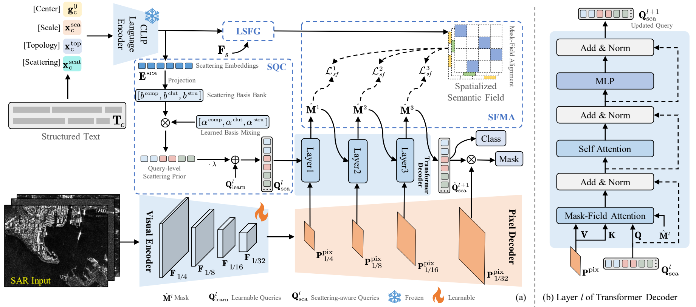
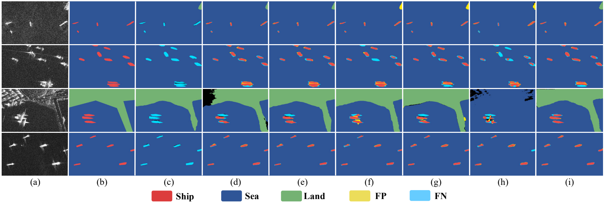
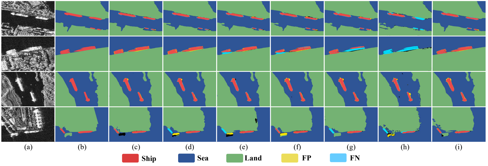
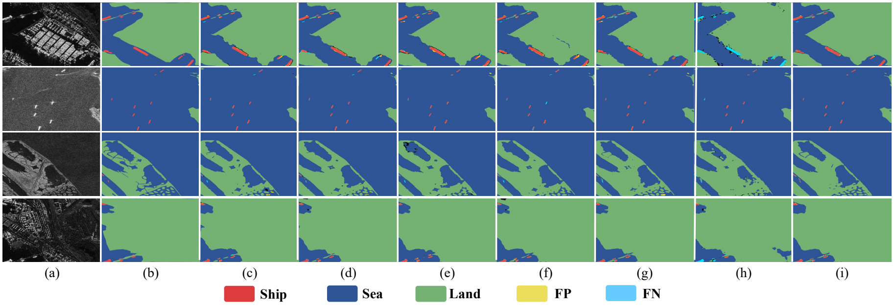

<div align="center">

# SLGSea

### Spatialized Language Guidance with Scattering-Aware Query Construction for Ship–Sea–Land Panoptic Segmentation in SAR Imagery

**Rong Deng · Tianwen Zhang · Gui Gao · Laiyun Zhang · Shunjun Wei · Xiaoling Zhang**

**Bringing spatial language guidance and scattering-aware queries to SAR panoptic segmentation.**

[Method](#method) · [Results](#results) · [Datasets](#datasets) · [Getting Started](#getting-started) · [Prompt Templates](#prompt-templates)

</div>



SLGSea jointly parses **ship instances, sea regions, and land regions** in SAR imagery. It transforms structured textual priors into a spatial semantic field and scattering-aware queries, connecting language knowledge with local visual evidence for panoptic decoding in cluttered maritime and coastal scenes.

- **Spatial language guidance.** Fuse scale, topology, and scattering descriptions with multi-scale SAR features to support region discrimination.
- **Scattering-aware queries.** Inject priors about compact ship responses, sea clutter, and structural land textures into learnable queries.
- **Region-level semantic feedback.** Align visual and semantic region representations through predicted masks, then feed the retrieved semantics back into query refinement.
- **Strong results across three benchmarks.** SLGSea achieves **74.40%, 88.64%, and 84.91% PQ** on SAR-SSP, SPSD, and HRSID-PAN, respectively.

## Method

Built on Mask2Former with a frozen CLIP text encoder, SLGSea introduces three complementary modules:

| Module | Role |
|---|---|
| **LSFG** · Language-aware Semantic Field Generation | Hierarchically combines structured text and multi-scale visual features to construct a spatial semantic field. |
| **SQC** · Scattering-aware Query Construction | Builds query-specific scattering priors from language-derived semantic references. |
| **SFMA** · Semantic Field-guided Mask Alignment | Uses predicted masks to read corresponding visual and semantic regions, align their representations, and refine subsequent queries. |

Training uses image-aligned structured descriptions. Inference uses shared, fixed descriptors whose text features can be precomputed.

## Results

Results from **Tables II–IV** of the paper. All metrics are reported in %. PQ, SQ, and RQ denote panoptic, segmentation, and recognition quality; PQ_th evaluates ship instances, while PQ_st evaluates sea and land regions.

| Dataset | PQ | SQ | RQ | PQ_th | PQ_st |
|---|---:|---:|---:|---:|---:|
| SAR-SSP | **74.40** | **88.47** | **82.56** | **47.58** | **87.80** |
| SPSD | **88.64** | **89.88** | **98.41** | **74.22** | **95.86** |
| HRSID-PAN | **84.91** | **91.38** | **92.52** | **71.25** | **91.74** |

SLGSea improves overall PQ over the strongest competing result on each dataset by **2.84, 2.21, and 1.37 percentage points**, respectively. The corresponding gains over the best competing ship-instance PQ are **4.49, 5.84, and 3.76 points**.

<details>
<summary><b>Full comparison across methods · PQ (%)</b></summary>

| Method | SAR-SSP | SPSD | HRSID-PAN |
|---|---:|---:|---:|
| Panoptic FPN | 68.66 | 82.37 | 80.54 |
| Panoptic-DeepLab | 53.60 | 72.37 | 76.34 |
| MaskFormer | 70.72 | 84.50 | 82.89 |
| Mask2Former | 66.25 | 85.12 | 82.62 |
| YOSO | 66.83 | 84.09 | 79.51 |
| Mask2Anomaly | 71.26 | 86.43 | 82.67 |
| ECLIPSE | 57.15 | 69.11 | 67.83 |
| UISE | 70.32 | 84.76 | 79.96 |
| MPSA | 56.25 | 76.60 | 75.69 |
| MFGS2Net | 68.40 | 85.15 | 81.75 |
| TSP-SD | 67.42 | 85.56 | 81.92 |
| X-Decoder | 71.56 | 86.37 | 83.54 |
| SEEM | 70.34 | 86.18 | 83.01 |
| OneFormer | 65.13 | 76.10 | 73.10 |
| OMG-Seg | 52.78 | 78.10 | 74.10 |
| PanoEarth | 52.01 | 75.35 | 74.16 |
| RemoteCLIP | 62.54 | 80.57 | 76.36 |
| SARCLIP | 68.30 | 85.30 | 80.94 |
| **SLGSea (Ours)** | **74.40** | **88.64** | **84.91** |

</details>

### Qualitative Comparisons

Columns show the SAR image, ground truth, MaskFormer, Mask2Former, Mask2Anomaly, MFGS2Net, X-Decoder, PanoEarth, and **SLGSea**, from left to right. Yellow and cyan indicate false positives (FP) and false negatives (FN).

**SAR-SSP · Ship parsing under different sea conditions (Fig. 5)**



**SPSD · Instance delineation in complex coastal scenes (Fig. 6)**



**HRSID-PAN · Joint ship–sea–land delineation (Fig. 7)**



## Datasets
链接: https://pan.baidu.com/s/1I7Q1hM3xAq5X5azDwkyfOA?pwd=8888 


| Dataset | Training images | Validation images | Ship instances (train / val) |
|---|---:|---:|---:|
| SAR-SSP | 929 | 232 | 461 / 139 |
| SPSD | 928 | 232 | 2041 / 547 |
| HRSID-PAN | 3642 | 1962 | 11033 / 5918 |

Each dataset follows the same layout, with COCO panoptic JSON annotations and RGB segment-ID PNG masks:

```text
datasets/
├── SAR-SSP/
├── SPSD/
└── HRSID-PAN/
    ├── train2017/
    ├── val2017/
    ├── annotations/
    │   ├── panoptic_train2017/
    │   ├── panoptic_val2017/
    │   ├── panoptic_train2017.json
    │   └── panoptic_val2017.json
    └── text_library/
        └── *_train.json
```

## Getting Started

### Installation

Use Python 3.9+ and install a compatible PyTorch / torchvision pair and [Detectron2](https://detectron2.readthedocs.io/en/latest/tutorials/install.html). Then install the remaining dependencies:

```bash
python -m pip install -r requirements.txt
```

Reference environment: PyTorch 2.8.0, torchvision 0.23.0, and Detectron2 0.6.

### Pretrained Initialization

Download the COCO panoptic visual weights:

```bash
python download_weights.py --model coco_panoptic_r50
```

The weights are saved to `weights/coco_panoptic_r50.pkl`. Precomputed CLIP text features for all three datasets are included in `assets/text_cache.pt` and are ready to use.

### Training

Run the command for your dataset from the repository root:

```bash
# SAR-SSP
python train.py --config configs/sarssp.yaml --init-weights weights/coco_panoptic_r50.pkl

# SPSD
python train.py --config configs/spsd.yaml --init-weights weights/coco_panoptic_r50.pkl

# HRSID-PAN
python train.py --config configs/hrsid_pan.yaml --init-weights weights/coco_panoptic_r50.pkl
```

The default configuration uses ResNet-50, 512×512 inputs, 100 queries, 9 decoder layers, and AdamW with a batch size of 8 and a learning rate of 1e-4. Training runs for 7,000 iterations on SAR-SSP / SPSD and 21,000 iterations on HRSID-PAN. See [configs/](configs/) for the full settings.

Use `--data-root` and `--output` to customize the data and output paths. To resume training:

```bash
python train.py --config configs/sarssp.yaml --resume outputs/sarssp/model_0000500.pt
```

### Evaluation and Inference

Evaluate a checkpoint on the validation split:

```bash
python evaluate.py --checkpoint outputs/sarssp/model_final.pt --data-root datasets/SAR-SSP --output outputs/sarssp_eval
```

Run inference on a single SAR image:

```bash
python predict.py --checkpoint outputs/sarssp/model_final.pt --image example.jpg --output outputs/example
```

Outputs include the panoptic segmentation map (`panoptic.png`), segment metadata (`segments.json`), and a color visualization (`preview.png`).

## Prompt Templates

Structured SAR descriptions capture **scale, topology, and scattering**. The integrated templates from Table I are:

| Class | Template |
|---|---|
| Ship | `{scale} ships are {topology}, with {scattering} around ship targets.` |
| Sea | `Sea regions are {scale} and show {topology}, with {scattering} on the sea surface.` |
| Land | `Land regions are {scale} and show {topology}, with {scattering} over land areas.` |

[templates.json](prompts/templates.json) contains integrated and attribute-specific templates, fixed inference descriptors, and SQC semantic references. Attribute vocabularies and discretization rules are provided in [recovered_attribute_rules.yaml](prompts/recovered_attribute_rules.yaml), with text assembly implemented in [prompts.py](slgsea/prompts.py).

<details>
<summary><b>Custom descriptions and text feature preparation</b></summary>

Training text libraries are JSON lists with `image_id`, `T_ship`, `T_sea`, and `T_land` fields. After updating descriptions, regenerate the feature cache with the bundled CLIP text encoder:

```bash
python download_weights.py --model openai_clip_rn50
python prepare_text.py --clip-weights weights/RN50.pt --data-root datasets/SAR-SSP datasets/SPSD datasets/HRSID-PAN --output assets/text_cache.pt
```

</details>

## Acknowledgements

We thank [Mask2Former](https://github.com/facebookresearch/Mask2Former) and [CLIP](https://github.com/openai/CLIP) for their open-source contributions.
